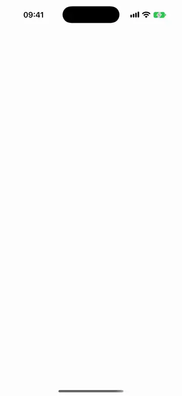
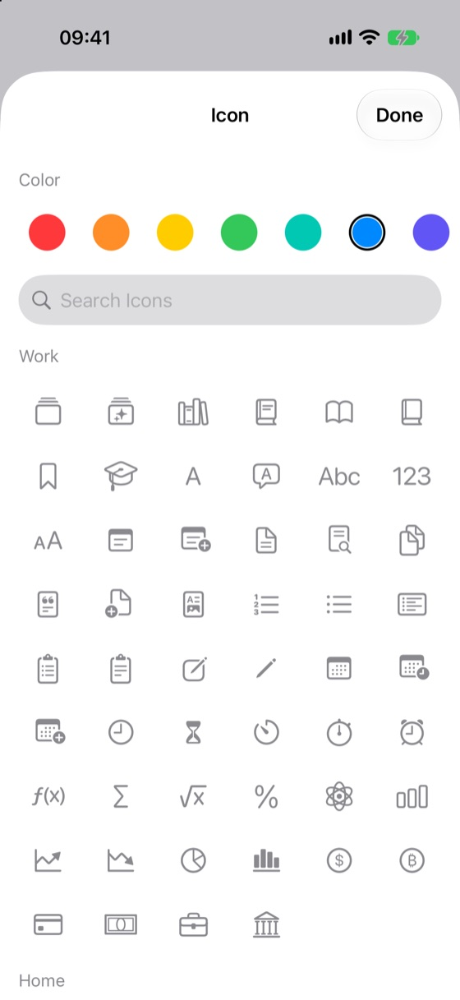
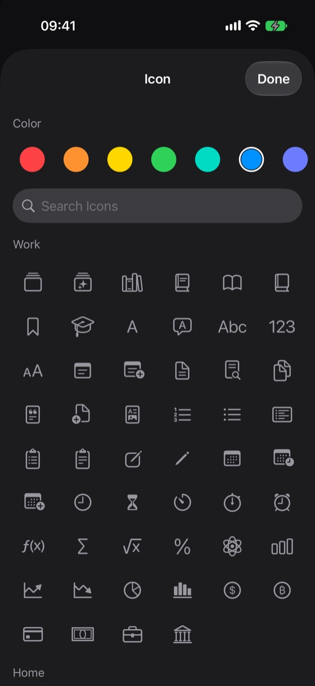
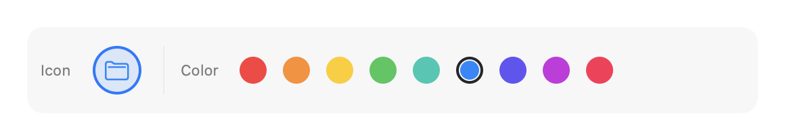
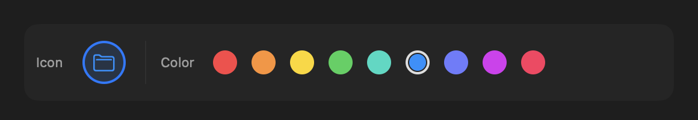
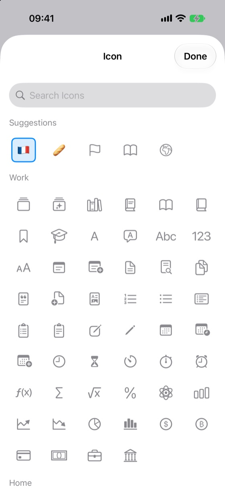
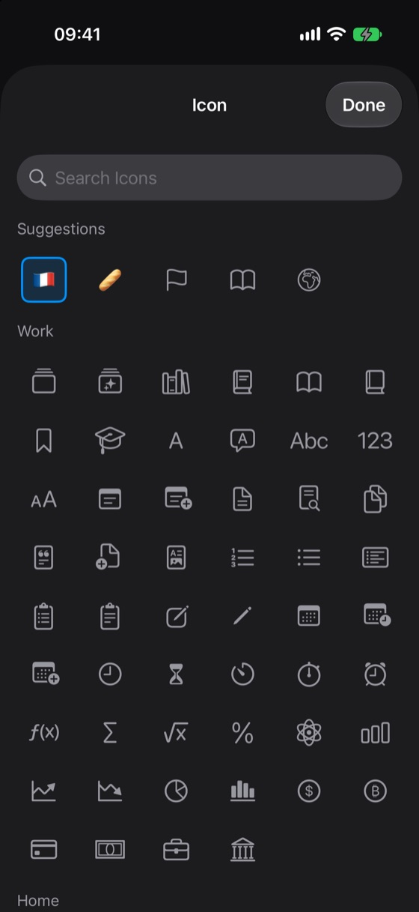

# IconPickerKit

A SwiftUI picker for a tint color plus an emoji or SF Symbol. Bind two values the consumer owns.

- `IconPickerView` — a full picker for an iPhone or iPad sheet or pushed screen.
- `IconPickerRow` — one form row: Icon on the left, Color swatches after a divider, one mixed-catalog popover. On Mac, embed this in the form. Do not present `IconPickerView` in a sheet.

## Preview

<p>
  
</p>

The picker opens on the selected icon. Pick a color and a symbol, then search. Choosing an emoji
hides Color, because only SF Symbols take the tint.

<p>
  
  
</p>

`IconPickerView`. Present it in a sheet; you own Done.

<p>
  
  
</p>

`IconPickerRow` in a form.

## Requirements

- iOS 26+ / macOS 26+
- Swift 6.2+

## Installation

Internal to the `hksw-io` org. Add:

```swift
.package(url: "https://github.com/hksw-io/iconpickerkit.git", from: "1.5.0")
```

```swift
.product(name: "IconPickerKit", package: "IconPickerKit"),
```

In Xcode: **File > Add Package Dependencies…** and enter the URL above. You need access to the org.
Add the `IconPickerKit` library product. Add `IconPickerKitIntelligence` too only if you want
[on-device model suggestions](#suggested-icons).

## Usage

On iPhone and iPad, present `IconPickerView` in a sheet. Bindings update live; you own dismissal. On Mac, skip the sheet and put `IconPickerRow` in the form instead.

The kit ships no strings of its own. Every picker takes `labels:`, the strings it shows and
speaks, from your app; [Labels](#labels) shows how to build `.app` below.

```swift
import SwiftUI
import IconPickerKit

struct EditItemView: View {
    @State private var icon = "folder"
    @State private var color = IconPickerColor.blue
    @State private var showingPicker = false

    var body: some View {
        Button("Icon") { self.showingPicker = true }
            .sheet(isPresented: self.$showingPicker) {
                NavigationStack {
                    IconPickerView(icon: self.$icon, color: self.$color, labels: .app)
                        .navigationTitle("Icon")
                        .toolbar {
                            ToolbarItem(placement: .confirmationAction) {
                                Button("Done") { self.showingPicker = false }
                            }
                        }
                }
            }
    }
}
```

`icon` is either an emoji (`"🐶"`) or an SF Symbol name (`"folder"`). Persist `icon` and
`color.id`, and restore with `IconPickerColor.all.first { $0.id == savedID }` (or your own
`colors`). Color is only offered for SF Symbols: while an emoji is selected the swatches hide and
`color` keeps its value.

One mixed catalog, grouped by meaning. The default order is Work, Home, Health, Places, Nature,
Objects, Activity, People, Symbols, Food, Smileys, Animals: tintable symbol groups first,
emoji-heavy groups last. Search Icons filters every group in the current catalog as you type.
Return picks the first result, and in `IconPickerRow` also closes the popover.

Pass `catalog` to choose which groups appear and in what order. Smileys first, say:

```swift
IconPickerView(
    icon: $icon,
    color: $color,
    catalog: IconCatalogPreset(
        groups: [.smileys] + IconGroup.allCases.filter { $0 != .smileys && $0 != .suggestions }),
    labels: .app)
```

Search trims surrounding whitespace and never reaches omitted groups. A miss shows the system's
search-empty state.

The icon the picker opens with always has a selected cell. If the catalog doesn't list it (an icon
picked from Suggestions last time, or your own default symbol), it leads the first group.

### Suggested icons

On-device model suggestions live in the separate `IconPickerKitIntelligence` product, the only
part of the package that links FoundationModels. Leave it out and your app never loads the model
framework or its dependencies at launch. Add it and import it next to `IconPickerKit`:

```swift
.product(name: "IconPickerKitIntelligence", package: "IconPickerKit"),
```

```swift
import IconPickerKit
import IconPickerKitIntelligence
```

Pass `hint:` and the picker asks the on-device model after it appears. Usable emoji or SF Symbol
names (a deck called `"French"` can surface 🇫🇷) show as a Suggestions group at the top. If the
model is off, unavailable, or returns nothing usable, the extra group is omitted. No API key.

```swift
IconPickerView(icon: $icon, color: $color, hint: deckName, labels: .app)
```

To have the group there on the first frame, await a result before presenting and pass it in:

```swift
@State private var ready = IconSuggestions.empty

// before presenting:
ready = await IconSuggestions.load(hint: deckName)
showingPicker = true

// in the sheet:
IconPickerView(icon: $icon, color: $color, suggestions: ready, labels: .app)
```

Replacing the hint or the ready result refreshes suggestions in an already-presented picker, and
clearing it clears the old suggestions. To supply your own suggestions without the model, use
`IconSuggestions.load(hint:produce:)` from `IconPickerKit` alone.

Color, search, and the current section title stay pinned above the catalog. On iPhone and iPad the picker scrolls to the current icon on first layout without waiting for suggestions, animates that scroll (Reduce Motion jumps instead), and skips it when the icon is already on screen or you have scrolled. On macOS it stays at the top. When suggestions arrive after appear, the group expands in at the top if you are still there; a scrolled catalog keeps its place.

<p>
  
  
</p>

### On Mac

Embed the compact row in the form. A full-picker sheet is the iPhone layout.

```swift
Form {
    IconPickerRow(icon: self.$icon, color: self.$color, labels: .app)
}
.formStyle(.grouped)
```

### Palette

```swift
let brand = IconPickerColor(id: "brand", color: .indigo)

IconPickerView(icon: self.$icon, color: self.$color, colors: [.blue, brand], labels: .app)
```

`IconPickerRow` takes the same `colors` and `labels` arguments. It has no `catalog`, `hint`, or
`suggestions`; its popover always shows every group.

### Your own icons

Lead the catalog with sections of your own, and tell the picker how to draw their icons:

```swift
let exercises = IconSection(
    id: "exercises",
    title: String(localized: "Exercises"),
    items: [IconItem(value: "Exercise-Squat", name: String(localized: "Squat"))])

IconPickerView(
    icon: $icon,
    color: $color,
    catalog: IconCatalogPreset(groups: [.activity, .health], leading: [exercises]),
    labels: .app,
    image: { item in
        item.value.hasPrefix("Exercise-") ? Image(item.value).renderingMode(.template) : nil
    })
```

Your sections come after Suggestions and before the catalog groups, and search covers their item
names, values, and keywords. Picking one sets `icon` to the item's `value`, which your app draws
itself everywhere else. `image` is asked about every cell, so return `nil` for an emoji or SF
Symbol. A template image takes the tint as a symbol does, and Color stays on screen for it. Give
each section an `id` that no `IconGroup` uses. `IconPickerRow` has no such hook: it draws only
emoji and SF Symbols.

### Labels

`IconPickerLabels` holds every string the picker shows or speaks, and none has a default. Build it
once from your app's localized strings:

```swift
extension IconPickerLabels {
    static var app: IconPickerLabels {
        IconPickerLabels(
            color: String(localized: "Color"),
            icon: String(localized: "Icon"),
            search: String(localized: "Search Icons"),
            clear: String(localized: "Clear"),
            noIcons: String(localized: "No Icons"),
            groupTitle: { group in
                switch group {
                case .work: String(localized: "Work")
                case .home: String(localized: "Home")
                case .health: String(localized: "Health")
                case .places: String(localized: "Places")
                case .nature: String(localized: "Nature")
                case .objects: String(localized: "Objects")
                case .activity: String(localized: "Activity")
                case .people: String(localized: "People")
                case .symbols: String(localized: "Symbols")
                case .food: String(localized: "Food")
                case .smileys: String(localized: "Smileys")
                case .animals: String(localized: "Animals")
                case .suggestions: String(localized: "Suggestions")
                }
            },
            colorName: { color in
                switch color.id {
                case "red": String(localized: "Red")
                case "orange": String(localized: "Orange")
                case "yellow": String(localized: "Yellow")
                case "green": String(localized: "Green")
                case "mint": String(localized: "Mint")
                case "blue": String(localized: "Blue")
                case "indigo": String(localized: "Indigo")
                case "purple": String(localized: "Purple")
                case "pink": String(localized: "Pink")
                default: color.id
                }
            })
    }
}
```

`color` and `icon` head the swatches and the row's icon button, `search` is the field's prompt,
`clear` names its clear button for VoiceOver, and `noIcons` shows when the catalog is empty.
`groupTitle` heads each group; switch over every case, so a group added later fails to compile
until you name it. `colorName` is a swatch's tooltip and VoiceOver name: cover the ids in the
palette you pass (`IconPickerColor.all` is the nine above).

Icon names and search keywords are the one thing built in: the catalog carries English metadata.
Override it by icon value, so changing language never changes a saved selection:

```swift
var labels = IconPickerLabels.app
labels.iconNames = ["folder": "Mapp", "📚": "Böcker"]
labels.iconKeywords = ["folder": ["dokument"]]
```

Names feed both search and VoiceOver; your keywords add to the built-in ones, and raw symbol IDs
stay searchable.

Search and classification are also public if you want the catalog without the view:

```swift
let sections = IconCatalog.search("dog", labels: .app)  // the picker's search: mixed, trimmed, localized
let kind = IconKind.classify("🐶")  // .emoji
let tintable = IconKind.offersColorChrome(for: "folder")  // true
```

## Local development

```sh
swift test
xcodebuild test -scheme IconPickerKit-Package -destination 'platform=iOS Simulator,name=iPhone 17 Pro'
swift run --package-path Demo GenerateMedia
./Demo/run-demo.sh
```

The tests run on macOS and on the iOS Simulator. The Mac-only demo app and media tool live in
`Demo`, a nested package that depends on this one by path, so they stay out of the iOS build.

Run `swift run --package-path Demo GenerateMedia` from the repository root in a logged-in macOS
session. It rewrites the
`IconPickerRow` stills in `Docs/Media`, which are Mac renders. The `IconPickerView` stills and the
demo are captured from the iOS 27.2 Simulator (iPhone 17 Pro), because a Mac render at phone width
would not show iOS touch sizing.

`./Demo/run-demo.sh` builds a real Mac app and opens it (Dock and Cmd-Tab). Catalog is the full picker with color and search pinned; its Demo section shows an app's own icons. Form row is the compact control, which cannot draw those. The inspector hint plus **Delay 2 seconds** starts canned suggestions after a pause so you can scroll first. **Reload** runs that again. Turn Delay off to use the on-device model.

## OS 27 compatibility

The deployment minimum remains iOS 26 / macOS 26, with Swift tools 6.2. CI runs the package tests
on macOS and on the iOS Simulator, and builds the demo package, with the Xcode 27.0 preview image,
which GitHub maintains as [`xcode-27`](https://github.com/actions/runner-images/issues/14404).
No CI job builds with an Xcode 26 toolchain, so new SDK-only APIs must preserve the existing
deployment and compiler minimums. Local SDK 27.2 validation complements the job; a local pass does
not establish the result of a hosted CI run.

## License

MIT. See [LICENSE](LICENSE).
