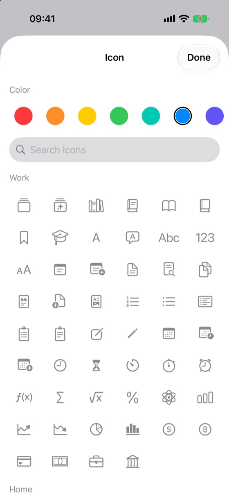
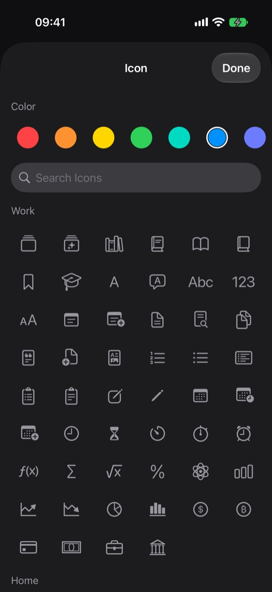
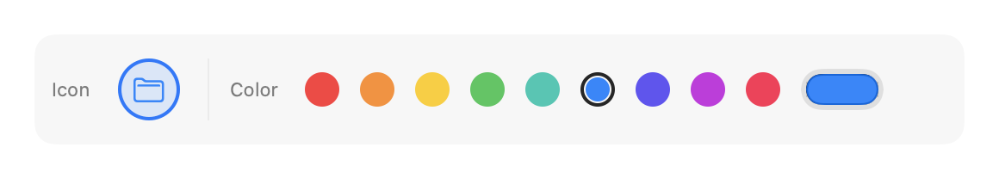
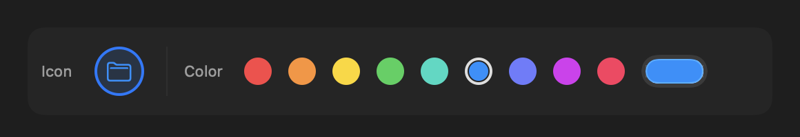
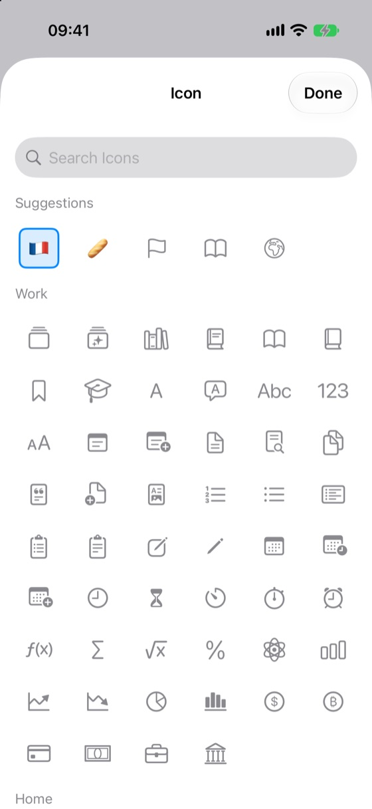
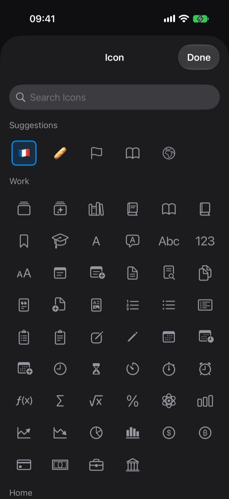

# IconPickerKit

A SwiftUI picker for a tint color plus an emoji or SF Symbol. Bind two values the consumer owns.

- `IconPickerView` — a full picker for an iPhone or iPad sheet or pushed screen.
- `IconPickerRow` — one form row: Icon on the left, Color swatches after a divider, one mixed-catalog popover. On Mac, embed this in the form. Do not present `IconPickerView` in a sheet.

## Preview

<p>
  
</p>

The picker opens on the selected icon. Pick a color and a symbol, then search. Choosing an emoji
hides Color, because only SF Symbols take the tint.

<p>
  
  
</p>

`IconPickerView`. Present it in a sheet; you own Done.

<p>
  
  
</p>

`IconPickerRow` in a form.

## Requirements

- iOS 26+ / macOS 26+
- Swift 6.2+

## Installation

Internal to the `hksw-io` org. Add:

```swift
.package(url: "https://github.com/hksw-io/iconpickerkit.git", from: "1.3.0")
```

```swift
.product(name: "IconPickerKit", package: "IconPickerKit"),
```

In Xcode: **File > Add Package Dependencies…** and enter the URL above. You need access to the org.
Add only the `IconPickerKit` library product; `IconPickerKitDemo` is a Mac-only demo app.

## Usage

On iPhone and iPad, present `IconPickerView` in a sheet. Bindings update live; you own dismissal. On Mac, skip the sheet and put `IconPickerRow` in the form instead.

```swift
import SwiftUI
import IconPickerKit

struct EditItemView: View {
    @State private var icon = "folder"
    @State private var color = IconPickerColor.blue
    @State private var showingPicker = false

    var body: some View {
        Button("Icon") { self.showingPicker = true }
            .sheet(isPresented: self.$showingPicker) {
                NavigationStack {
                    IconPickerView(icon: self.$icon, color: self.$color)
                        .navigationTitle("Icon")
                        .toolbar {
                            ToolbarItem(placement: .confirmationAction) {
                                Button("Done") { self.showingPicker = false }
                            }
                        }
                }
            }
    }
}
```

`icon` is either an emoji (`"🐶"`) or an SF Symbol name (`"folder"`). Persist `icon` and
`color.id`, and restore with `IconPickerColor.all.first { $0.id == savedID }` (or your own
`colors`). With `allowsCustomColor`, a custom pick has `id == IconPickerColor.customID`, so also
persist its resolved color and rebuild it with `IconPickerColor.custom(_:)`. Color is only offered
for SF Symbols: while an emoji is selected the swatches hide and `color` keeps its value.

One mixed catalog, grouped by meaning. The default order is Work, Home, Health, Places, Nature,
Objects, Activity, People, Symbols, Food, Smileys, Animals: tintable symbol groups first,
emoji-heavy groups last. Search Icons filters every group in the current catalog. Keystrokes
debounce for 250 ms.

Presets set which groups appear, their order, and how many items each shows:

```swift
IconPickerView(icon: $icon, color: $color, catalog: .compact)
```

`.all` is every group, uncapped. `.compact` is Work 12, Home 8, Places 8, Objects 12, Symbols 8,
People 8. `.work` is Work 16, Home 12, Objects 12. Or build your own — Smileys first, 8 each:

```swift
IconPickerView(
    icon: $icon,
    color: $color,
    catalog: IconCatalogPreset(
        groups: [.smileys] + IconGroup.allCases.filter { $0 != .smileys && $0 != .suggestions },
        limit: 8))
```

For different caps per group, pass
`IconCatalogPreset([IconSectionLimit(.work, limit: 12), IconSectionLimit(.smileys)])`.

Search ignores positive browse caps and trims surrounding whitespace. Omitted groups and groups
with a zero or negative limit remain excluded. A miss shows the system's search-empty state.

### Suggested icons

Start the on-device model **before** presenting the picker so the Suggestions group can already be there. Hold the task on the screen that opens the sheet (an edit form, a deck name field, …) and pass it in:

```swift
@State private var suggestions: Task<IconSuggestions, Never>?

.task(id: deckName) {
    let task = IconSuggestions.preload(hint: deckName)
    suggestions = task
    await withTaskCancellationHandler {
        _ = await task.value
    } onCancel: {
        task.cancel()
    }
}

.sheet(isPresented: $showingPicker) {
    IconPickerView(icon: $icon, color: $color, suggestions: suggestions)
}
```

Or await a finished result and pass that — the extra group is on the first frame:

```swift
@State private var ready = IconSuggestions.empty

// before presenting:
ready = await IconSuggestions.load(hint: deckName)
showingPicker = true

// in the sheet:
IconPickerView(icon: $icon, color: $color, suggestions: ready)
```

Replacing the task, ready result, or hint refreshes suggestions in an already-presented picker.
The picker ignores cancelled requests; the caller owns cancellation of supplied preload tasks,
as in the example above. Clearing the hint or supplied result clears the old suggestions.

Passing only `hint:` still asks the model after appear. Usable emoji or SF Symbol names (a deck called `"French"` can surface 🇫🇷) show as a Suggestions group at the top. If the model is off, unavailable, or returns nothing usable, the extra group is omitted. No API key. If you pass both `hint:` and a `suggestions:` task, the task wins.

```swift
IconPickerView(icon: $icon, color: $color, hint: deckName)
```

Color, search, and the current section title stay pinned above the catalog. On iPhone and iPad the picker scrolls to the current icon on first layout without waiting for suggestions, animates that scroll (Reduce Motion jumps instead), and skips it when the icon is already on screen or you have scrolled. On macOS it stays at the top. When suggestions arrive after appear, the group expands in at the top if you are still there; a scrolled catalog keeps its place.

<p>
  
  
</p>

### On Mac

Embed the compact row in the form. A full-picker sheet is the iPhone layout.

```swift
Form {
    IconPickerRow(icon: self.$icon, color: self.$color)
}
.formStyle(.grouped)
```

### Palette, symbols, and labels

```swift
let brand = IconPickerColor(id: "brand", name: "Brand", color: .indigo)

IconPickerView(
    icon: self.$icon,
    color: self.$color,
    colors: [.blue, brand],
    symbols: ["folder", "star", "heart"],
    allowsCustomColor: true,
    labels: IconPickerLabels(
        color: String(localized: "picker.color"),
        icon: String(localized: "picker.icon"),
        search: String(localized: "picker.search"),
        customColor: String(localized: "picker.customColor"),
        suggestions: String(localized: "picker.suggestions")))
```

`IconPickerRow` takes the same `colors`, `symbols`, `allowsCustomColor`, and `labels` arguments.
It has no `catalog`, `hint`, or `suggestions`; its popover always shows every group.

`symbols:` is an allow-list: curated groups keep only the SF Symbols you pass, and emoji are
unaffected. Start from `SymbolCatalog.ids` to add to the defaults.

Supplied SF Symbols outside the curated groups appear in Symbols, in caller order, without
duplicates. Include `.symbols` when using a custom preset if these icons should be available.
They come after the curated Symbols items, so a positive `.symbols` cap (as in `.compact`) hides
them while browsing; search still finds them.

Localize the catalog as well as its chrome through `IconPickerLabels`. Metadata is keyed by
stable icon values and color IDs, so changing language never changes saved selections:

```swift
let labels = IconPickerLabels(
    color: "Färg", icon: "Ikon", search: "Sök ikoner", customColor: "Anpassad",
    suggestions: "Förslag", clear: "Rensa", noIcons: "Inga ikoner",
    groupTitles: [.home: "Hem", .work: "Arbete"],
    iconNames: ["folder": "Mapp", "📚": "Böcker"],
    iconKeywords: ["folder": ["dokument"]],
    colorNames: ["blue": "Blå"])
```

Use your app's localized strings for these values. Names feed both search and VoiceOver;
localized keywords supplement existing keywords, and raw symbol IDs remain searchable.
The public `IconCatalog` methods also accept `labels:` and return localized section titles
and item metadata. Missing overrides retain the English defaults. Section titles come from
`groupTitles` (Suggestions falls back to `suggestions`); the `emojis` and `symbols` labels are
unused.

Search and classification are also public if you want the catalogs without the view:

```swift
let sections = IconCatalog.search("dog")  // the picker's search: mixed, trimmed, localizable
let emoji = EmojiCatalog.search("dog")  // emoji only, English metadata
let kind = IconKind.classify("🐶")  // .emoji
let tintable = IconKind.offersColorChrome(for: "folder")  // true
```

## Local development

```sh
swift test
swift run GenerateMedia
./scripts/run-demo.sh
```

Run `swift run GenerateMedia` from the package root in a logged-in macOS session. It rewrites the
`IconPickerRow` stills in `Docs/Media`, which are Mac renders. The `IconPickerView` stills and the
demo are captured from the iOS 27.2 Simulator (iPhone 17 Pro), because a Mac render at phone width
would not show iOS touch sizing.

`./scripts/run-demo.sh` builds a real Mac app and opens it (Dock and Cmd-Tab). Catalog is the full picker with color and search pinned. Form row is the compact control. The inspector hint plus **Delay 2 seconds** starts canned suggestions after a pause so you can scroll first. **Reload** runs that again. Turn Delay off to use the on-device model.

## OS 27 compatibility

The deployment minimum remains iOS 26 / macOS 26, with Swift tools 6.2. CI runs package tests
on macOS and builds the iOS Simulator library with Xcode 26.6 and the Xcode 27.0 preview image.
The aggregate test scheme includes the Mac-only demo/media executables, so hosted iOS interaction
checks use a native consumer app rather than that aggregate scheme. Each job selects
its toolchain generation explicitly; the 27 image is maintained by GitHub as
[`xcode-27`](https://github.com/actions/runner-images/issues/14404). New SDK-only APIs must
preserve the existing deployment and compiler minimums. Local SDK 27.2 validation complements
these jobs; a local pass does not establish the result of a hosted CI run.

## License

MIT. See [LICENSE](LICENSE).
